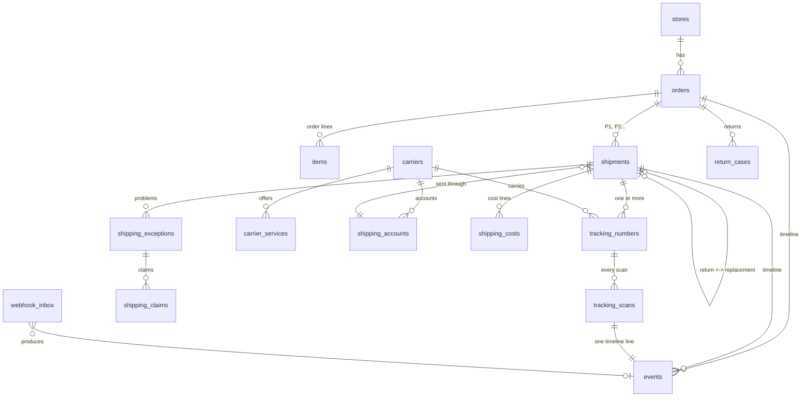
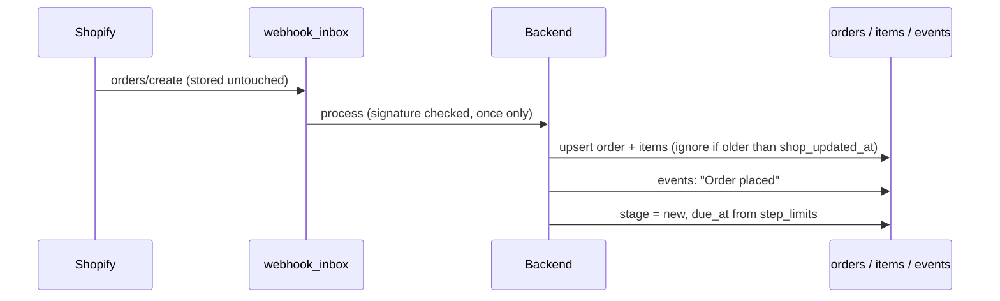
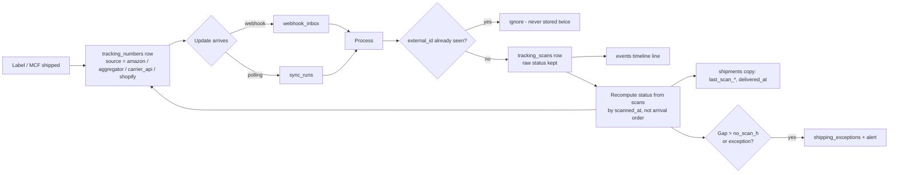
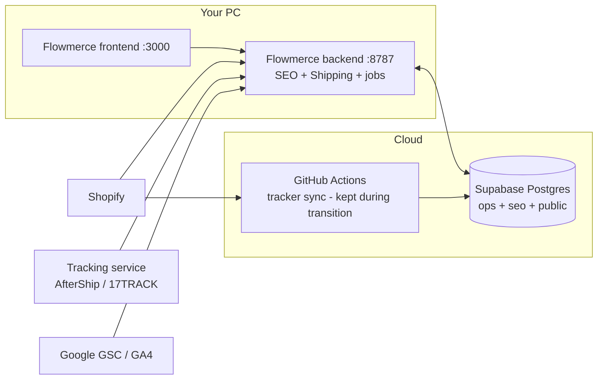
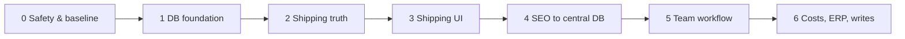

# Flowmerce — Database Explained & Build Plan

**Date:** 2026-11-17
**Based on:** `Ridhi_Shopify_Database_v2_Flowmerce.html` (the schema), the Flowmerce audit, and the Delayed Orders Tracker audit.
**Status of this document:** a plan only. No code, database, or file in either project has been changed.

---

## Contents

1. What the schema is, in one page
2. The 20 tables and 5 views, explained by group
3. Who writes what (the five "writers")
4. The workflows, end to end
5. How this fits with what exists today (gaps and clashes)
6. Target architecture
7. The build plan, in phases
8. Decisions needed from you
9. Risks and how we handle them
10. Definition of done

---

## 1. What the schema is, in one page

The schema is a **Supabase (PostgreSQL) design for running Ridhi's orders end to end**. It is much bigger than "a shipping tracker":

- It follows every **Shopify order** from the moment it is placed → checked → routed (Amazon MCF / India courier / production) → packed → shipped → in transit → delivered → closed, including **returns and replacements**.
- It keeps a **complete timeline** of everything that happened to an order (`events`).
- It tracks **every tracking number and every carrier scan** (`tracking_numbers`, `tracking_scans`). This is the piece that fixes today's shipping-accuracy problem.
- It raises **alerts** when something is late or stuck, sends them to the right person, and **escalates** (person → team head → owner) if nobody answers.
- It records **costs, rate cards, claims, and exceptions** for shipping.
- It stores **every incoming message** (Shopify / Amazon / carrier webhooks) untouched before acting on it, so nothing is lost and anything can be replayed.

**Design principles visible in the schema** (these are good and we should keep them):

| Principle | Where you see it |
|---|---|
| Every row knows its store (`RBP` or `CPC`) | `store` column on almost every table |
| Shopify's data and our team's data are kept apart | `orders`: left half = Shopify copy, right half = our status |
| Nothing is handled twice | unique `external_id` on `events`, `tracking_scans`, `webhook_inbox` |
| Old messages never overwrite new data | `orders.shop_updated_at`: a late, older message is ignored |
| Risky writes are **off by default** | `settings.shopify_writes = false`, `amazon_writes = false`, `auto_mcf = false` |
| Secrets never in the database | `shipping_accounts.credential_ref` holds only a *pointer* to the secret |
| Costs are private | `people.can_see_costs` controls who sees fees and margins |
| Same status words for every carrier | `tracking_numbers.status`: pending · info_received · in_transit · out_for_delivery · delivered · exception · returned · expired |
| Original carrier text is kept | `tracking_scans.raw_status`, `message`, `raw` |

**What the schema does NOT contain:** any **SEO & Blog** tables. The SEO module (articles, topics, keywords, Search Console, GA4, AI jobs, and so on) lives today in Flowmerce's SQLite file and must be **added** to this database as its own section (see §6).

---

## 2. The tables, explained by group

### A. Set-up (the foundation)

| Table | What it holds | Example |
|---|---|---|
| `stores` | The two Shopify stores | `RBP` Ridhi Block Print, `CPC` Cotton Print Club |
| `people` | Everyone who signs in: team, title, head of team, which sections and stores they see, whether they see costs | Shipment Head, Packer, QC, Orders Desk |
| `settings` | One shared place for every rule: write switches, working hours, step time limits, escalation, reason lists, GST numbering | `step_limits.no_scan_h = 72` |

### B. Orders and work (the core)

| Table | What it holds |
|---|---|
| `orders` | One row per Shopify order. Shopify's copy (customer, address, money, status) plus our part (stage, due time, late flag, hold, dispute, open alerts) |
| `items` | One row per order line. Shopify's quantities (ordered / edited / refunded / shipped / **still open**) plus our decision: route (mcf · india · make · skip), send quantity, shelf |
| `shipments` | **Anything that moves**: an MCF parcel, an India parcel, a production job, a return, a replacement. Holds the current step, who is responsible, due time, carrier, tracking numbers (copy), MCF id, Shopify fulfillment id, GST invoice number, weight, cost |
| `stock` | Stock per store and SKU, copied from the **ERP** every 15 minutes (FBA, India, shelf, in production) |

### C. History and alerts

| Table | What it holds |
|---|---|
| `events` | **Everything that happened, once**: Shopify messages, step changes, scans, notes, actions, and alerts with their whole life (opened → seen → answered → escalated → closed). The order timeline on screen is just these rows |

### D. Carriers, costs and rates

| Table | What it holds |
|---|---|
| `carriers` | Each carrier once: DHL, FedEx, Amazon Logistics US, Shiprocket, Delhivery, with the exact Shopify name and tracking-page link |
| `carrier_services` | Service levels (Express, Standard, Surface) with normal delivery days. `days_max` decides **"late"** |
| `shipping_accounts` | The accounts we ship through (Ridhi FBA, CPC FBA, DHL India, tracking service). Holds a pointer to the secret only |
| `shipping_costs` | Real cost lines per shipment (freight, fuel, MCF fee, duty). Estimates are replaced by invoice figures |
| `rate_cards` | What a carrier *should* charge, by service, country and weight. Used to estimate, and to spot overcharges |

### E. Tracking and problems (the accuracy fix)

| Table | What it holds |
|---|---|
| `tracking_numbers` | **The truth for tracking.** One row per tracking number: carrier, **source of updates** (shopify · amazon · aggregator · carrier_api · manual), normalized status, picked-up / last-scan / delivered times, ETA, promised date, scan count |
| `tracking_scans` | **Every scan**, in full: when it happened (carrier clock), when we received it, normalized status, raw carrier status, message, place, raw payload. Never stored twice |
| `shipping_exceptions` | Each problem (delay, damage, lost, failed delivery, customs hold) from detection to resolution |
| `shipping_claims` | Money we ask a carrier for, and what they paid |
| `return_cases` | Each return / sent-back parcel: reason, condition, outcome (refund · replace · restock) |

### F. Data feeds (the plumbing)

| Table | What it holds |
|---|---|
| `webhook_inbox` | Every incoming message from Shopify, Amazon, the tracking service, or a carrier, **stored untouched first**, then processed. Failed ones can be retried or replayed |
| `sync_runs` | A log of every load and check (first backfill, nightly check, polling, replay): when, how many rows, errors. **This powers "data freshness" on screen** |

### G. Views (worked out live, not stored)

| View | What it shows |
|---|---|
| `stock_free` | Stock minus what open shipments already hold, so the same pieces are never promised twice |
| `alert_board` | Every open alert with its order and shipment ("My alerts") |
| `daily` | Morning numbers per store and day: orders, shipped, late (sales for cost-allowed people) |
| `order_shipping_cost` | What shipping cost vs what the customer paid |
| `carrier_performance` | Per carrier, service, country, month: parcels, delivered, average transit days, on-time %, problems |

### How the tables connect



---

## 3. Who writes what — the five "writers"

Every column in the schema is labelled with **who is allowed to fill it**. This is the most important rule for data accuracy: a person can never type over Shopify's data, and a sync can never overwrite a person's decision.

| Writer | Meaning | Examples |
|---|---|---|
| **Shopify sync** | Filled from Shopify (webhooks + 4-month backfill + nightly check). Never typed by a person | order totals, address, `open_qty`, `shopify_fulfillment_id` |
| **Our team** | Set by people in the app, through the backend, after a permission check | route, hold reason, responsible person, carrier choice |
| **Backend job** | Worked out by a scheduled job | stage, due time, late flag, alerts, escalation |
| **ERP** | Copied from the ERP every 15 minutes | stock, PPC route, production order number |
| **Carrier** | Amazon MCF, DHL, FedEx, Shiprocket, Delhivery, or the tracking service | status, scans, ETA, delivered time |

---

## 4. The workflows, end to end

### 4.1 Order comes in



### 4.2 Order is checked and routed

1. Orders desk checks payment, address, note → `orders.checked_by / checked_at`, stage → **checked**.
2. For each item, a route is chosen in priority order **MCF → India → Production**, using `stock_free` so the same stock is not promised twice (oldest order first).
3. A `shipments` row is created per parcel or job (P1, P2...). Partial sends are allowed via `send_qty`.

### 4.3 Three kinds of shipment

| Kind | Steps |
|---|---|
| **MCF** (Amazon ships from FBA stock) | packed/sent to Amazon → shipped → transit → out → delivered. `mcf_id` (e.g. `SHOP-RBP7752-P1`) is fixed so Amazon refuses a duplicate. **Real sends are off until `amazon_writes` is on** |
| **India** (ship from India by courier) | packed → label → shipped → transit → out → delivered. Grouped into a `dispatch_file`; GST invoice number taken in one locked step |
| **Make** (production) | requested → print → cut → stitch → jobwork → received → qc → ready, then becomes an India parcel |

Every step change writes an `events` row and updates `step_times`.

### 4.4 Tracking (this is how shipping becomes accurate)



The key rules:

- **The status is worked out from the scans**, sorted by when the scan *happened* (`scanned_at`), not by when we received it. A late-arriving old scan cannot overwrite a newer one.
- **The source is always recorded.** The screen can say *"Delivered — confirmed by DHL"* versus *"Fulfilled — from Shopify only, not carrier-confirmed"*.
- **Nothing is invented.** No scan means `pending` / unverified, not "in transit".

### 4.5 Alerts and escalation

1. A job (every 15 minutes) checks due times using **working hours only** (Mon–Sat 10:00–19:00 IST).
2. Late or stuck → an `alert` event, assigned to the **responsible person** (level 1).
3. The person picks a reason and promises a new time.
4. No answer within 4 working hours → **team head** (level 2) → **owner** (level 3).
5. When the item moves on, the alert closes automatically (`closed_by = auto`).
6. Each morning at 09:30: one summary per person, plus late / shipped / order counts.

### 4.6 Problems, returns, costs

- **Exception** found (delay, lost, damaged, customs) → `shipping_exceptions` → may lead to a `shipping_claims` row.
- **Return** → `return_cases` + a `shipments` row of kind `return` → outcome refund / replace (replacement shipment linked with `linked_id`) / restock.
- **Costs** → estimate from `rate_cards` at label time → replaced by the real invoice line → `order_shipping_cost` view shows margin.

### 4.7 Data freshness

Every feed run writes `sync_runs`. The UI reads the latest successful run per source and shows **"Shopify synced 12 min ago ✓"** or **"Tracking service: last success 3 days ago ⚠"**. Old data is never shown as live.

---

## 5. How this fits with what exists today

### 5.1 What exists right now

| Thing | Where | Shape |
|---|---|---|
| Flowmerce SEO data | SQLite file `data/blog-ops.sqlite` (20 tables) | articles, topics, keywords, gsc/ga4, ai_jobs, audit_log... |
| Tracker shipping data | Supabase `public` schema | `shipments` (one row per fulfillment + tracking), `sync_runs`, `order_checks`, `manual_status` |
| Tracker sync | GitHub Actions, hourly | writes `public.shipments` with the service key |
| Unified DB draft | `D:\Flowmerce\db\unified` (core / seo / shipping / integrations) | designed, never run |
| Older draft | `D:\Flowmerce\db\schema.sql` (~11 schemas) | competing design |

### 5.2 Clashes we must handle (do not skip these)

| # | Clash | Why it matters | Proposed handling |
|---|---|---|---|
| C1 | **Table names collide.** v2 has `shipments` and `sync_runs`; the tracker already has `public.shipments` and `public.sync_runs` with **different columns** | Creating v2 in `public` would break the hourly sync or overwrite live data | Create v2 in **its own schema** (e.g. `ops`) and leave the tracker's tables untouched until cut-over |
| C2 | **Store codes differ.** v2 uses `RBP` / `CPC`; Flowmerce uses `ridhi` / `cpc` | Joins between SEO and shipping data would fail | One mapping, decided once (recommend `RBP`/`CPC` as the stored code; Flowmerce shows names) |
| C3 | **Sign-in.** `people.id` points to Supabase Auth (Google sign-in). Flowmerce today has **no login**, and you asked not to add one | Permissions, "responsible person", escalation all need *someone* to be identified | Decision needed (§8, D3) |
| C4 | **Webhooks need a public address.** Shopify, Amazon and AfterShip push messages to an HTTPS URL. Flowmerce only listens on `127.0.0.1` | Without a public endpoint, `webhook_inbox` never fills | Phase 1 uses **polling only**; webhooks come later via Supabase Edge Function or a hosted backend (§8, D4) |
| C5 | **Three database designs** (v2 HTML, `db/unified`, `db/schema.sql`) | Confusion about which one is the truth | Make **v2 + a new SEO section** the single design; mark the other two "superseded" (do not delete) |
| C6 | **No tracking source connected.** v2 assumes AfterShip/17TRACK or carrier APIs | Without one, `tracking_scans` stays almost empty and accuracy cannot improve beyond Shopify's data | Choose a tracking service (§8, D2) |
| C7 | **ERP feed** (`stock`, `ppc_route`, `erp_order_no`) | We have no ERP connection details | Leave `stock` empty until ERP access exists; routing stays manual |
| C8 | **Postgres driver** | The Python backend needs `psycopg` to talk to Postgres; not installed | Needs your approval (§8, D1) |

### 5.3 Existing tracker data → v2 mapping (no data lost)

| Tracker today | Goes to (v2) | Notes |
|---|---|---|
| `public.shipments` row (fulfillment + tracking) | `ops.shipments` (one per fulfillment) + `ops.tracking_numbers` (one per tracking number) | `source = 'shopify'`; status mapped to v2 words; **original status kept** |
| `last_scan_at / description / location` | one `ops.tracking_scans` row **only if a real scan time exists** | Never invent a scan from a sync time |
| `public.order_checks` | `ops.orders` (Shopify half) | the MCF "note says DONE" check becomes a query |
| `public.manual_status` | `ops.events` (type `note`/`action`) + `ops.shipping_exceptions` where relevant | team marks preserved with who/when |
| `public.sync_runs` | `ops.sync_runs` (`source='shopify'`, `kind='poll'`) | history kept |

---

## 6. Target architecture

### 6.1 One database, separate sections

One Supabase PostgreSQL project. Inside it, **schemas** (folders) keep modules apart:

```
Supabase PostgreSQL (one database)
├─ ops            ← the v2 schema: stores, people, settings, orders, items, shipments,
│                   tracking_*, events, carriers, costs, returns, webhook_inbox, sync_runs, views
├─ seo            ← today's 20 SQLite tables, moved over:
│                   topics, keywords, articles, article_revisions, review_notes,
│                   publish_requests, workflow_runs, gsc_*, ga4_page_daily, products,
│                   brand_settings, ai_jobs, ai_job_events, imports, integration_status
├─ public         ← the tracker's current tables, untouched until cut-over
└─ (shared)       ← ops.stores, ops.people, ops.settings, audit log used by BOTH modules
```

- **Shared by both modules:** `stores`, `people`, `settings`, audit log, `sync_runs`.
- **SEO only:** the `seo` schema.
- **Shipping only:** orders → shipments → tracking → exceptions → costs in `ops`.
- A problem in one section does not stop the other.

### 6.2 One backend, separate modules

```
src/flowmerce/
├─ core/            database connection (one pool), settings, logging, errors, audit
├─ modules/seo/     existing SEO routes and services (kept; only the DB layer changes)
├─ modules/shipping/ shipping routes and services, rewritten to read ops.* tables
│   ├─ tracking/    status mapping, scan processing, "latest status" logic
│   └─ diagnostics/ problem-shipment checks
├─ integrations/    Shopify, Google, Claude, Supabase, tracking service clients
└─ jobs/            scheduler: Shopify poll, tracking poll, alerts (15 min), morning summary
```

### 6.3 One frontend

The existing Flowmerce Next.js app (JavaScript/JSX only): **Home · SEO & Blog · Shipping · Settings**. The Shipping pages read the new backend routes; the old 336 KB HTML dashboard is retired after cut-over (kept in its repo, not deleted).

### 6.4 Where things run



---

## 7. The build plan, in phases

Each phase ends with something working and tested. Nothing in a later phase starts until the earlier one is verified.

### Phase 0 — Safety first (before any change)

- Back up the SQLite file and export the Supabase tables (read-only).
- Protect the uncommitted Flowmerce work (Shipping module, unified DB tooling, frontend). **Needs your OK for a local commit or a zip backup** (§8, D5).
- Record a baseline: all tests (502 SEO, 172 Shipping/DB, 54 frontend), screen timings, row counts.
- Get the tracker repo onto this PC.

**Done when:** backups exist, baseline numbers are written down.

### Phase 1 — Database foundation

- Create schema `ops` in Supabase with the set-up tables: `stores`, `settings`, `carriers`, `carrier_services`, `shipping_accounts`, `sync_runs`, `webhook_inbox`.
- Seed stores (RBP, CPC), carriers, services, and settings (all write switches **off**).
- Write migrations as numbered SQL files that can run more than once safely, each with a matching rollback file.
- Add the Postgres connection to the backend's `core/` (one shared pool).

**Done when:** the backend can read `ops.stores` and `ops.settings`; SEO still runs unchanged on SQLite.

### Phase 2 — Shipping truth (the accuracy fix)

- Create `orders`, `items`, `shipments`, `tracking_numbers`, `tracking_scans`, `events`, `shipping_exceptions`.
- **Shopify poll job** in the backend: backfill 4 months, then a check every few minutes, writing the Shopify half of `orders` / `items` and fulfillments → `shipments` + `tracking_numbers` (`source='shopify'`).
- **Status mapping layer:** every Shopify / carrier status → one v2 word, with the original kept. Unknown → `pending` / unverified, never "delivered".
- **Latest-status logic:** recompute from scans by `scanned_at`; ignore duplicates by `external_id`.
- **Migrate the tracker's history** into the new tables (§5.3), with a row-count and spot-check report.
- **Diagnostics:** tracking number with no scans; no scan for longer than `no_scan_h`; missing carrier; status contradicts scans; sync failed; duplicate shipments; exception still open.
- **Tracking service** (if approved, D2): register each tracking number and poll it → real carrier scans.

**Done when:** every open shipment shows its source and freshness; the discrepancy report (Flowmerce vs Shopify vs carrier) is produced for a sample of real orders.

### Phase 3 — Unified UI for Shipping

- Shipping pages read the new routes: overview, shipments list (paged, filters), detail drawer **with full scan timeline**, exceptions, diagnostics, analytics (`carrier_performance`).
- Data-freshness badges from `sync_runs`.
- Home shipping card from summary queries (not full tables).
- Make the frontend default to **live data** (demo only on purpose).

**Done when:** the Shipping tab fully replaces the old HTML dashboard for daily use.

### Phase 4 — Move SEO into the central database

- Create the `seo` schema (port of the 20 SQLite tables; brand ids mapped to store codes).
- Copy the data over with the existing `unified_db` tooling (insert-only, all-or-nothing), then verify counts and checksums.
- Switch the SEO backend from SQLite to Postgres behind the shared `core` connection.
- Run all 502 SEO tests plus a manual walk-through of every SEO page and action.
- Keep the SQLite file as the rollback for at least 30 days.

**Done when:** SEO works exactly as before, now on the central database.

### Phase 5 — Team workflow (needs sign-in decision D3)

- `people`, permissions by section and store, cost visibility.
- Order checking, holds, routing, step changes, responsible person.
- Alerts with working-hours clocks, escalation, morning summary.
- Returns (`return_cases`) and replacements.

### Phase 6 — Money and outside systems (each needs separate approval)

- `shipping_costs`, `rate_cards`, `shipping_claims`, cost views.
- ERP stock feed → `stock` and `stock_free`.
- Webhooks (public endpoint) → `webhook_inbox`.
- **Writes** to Shopify (mark shipped) and Amazon (create MCF orders), each behind its `settings` switch, off by default.
- GST invoice numbering.
- Retire the GitHub Actions tracker once the backend sync has run reliably for 2+ weeks.

### Timeline overview



Phases 2–3 come **before** moving SEO on purpose: SEO works today, so it is the safest to move last; Shipping accuracy is where the business pain is.

---

## 8. Decisions needed from you

> **2026-11-17: all recommendations below accepted by the owner.** D2 still needs the owner to pick AfterShip or 17TRACK and create the account (Claude cannot create accounts).

| # | Decision | Options | Recommendation |
|---|---|---|---|
| D1 | Install the Postgres driver `psycopg` | Yes / No | **Yes**: no central Postgres database is possible from Python without it |
| D2 | Tracking source for real carrier scans | AfterShip · 17TRACK · direct carrier APIs (DHL/FedEx) · none yet | **A tracking service** (one integration covers DHL, FedEx, Amazon, Delhivery). Has a monthly cost |
| D3 | Sign-in | (a) keep no login, single operator · (b) Google sign-in via Supabase Auth, as the schema assumes | **(a) for Phases 0–4, (b) at Phase 5**: alerts and escalation need named people |
| D4 | Where the backend runs long-term | Your PC only · a small hosted server · Supabase Edge Functions for webhooks | **PC for now, polling only**; decide hosting before Phase 6 |
| D5 | Protect uncommitted work | Local commit (no push) · zip backup only | **Local commit on a safety branch**, no push |
| D6 | Store code | `RBP/CPC` or `ridhi/cpc` | **`RBP/CPC`** (matches the schema) |
| D7 | Tracker during transition | Keep the hourly GitHub sync running in parallel | **Keep it** until the new sync proves itself |
| D8 | Data retention | `webhook_inbox` 13 months (proposed), order notes, audit IPs | Confirm 13 months |

---

## 9. Risks and how we handle them

| Risk | Handling |
|---|---|
| Breaking the live hourly sync | New tables go in schema `ops`; `public.*` untouched until cut-over |
| Losing SEO functionality | SEO moves last; full test suite and page-by-page check; SQLite kept as rollback |
| Showing wrong shipping status | Source and freshness on every status; unknown = unverified; never invent scans |
| Duplicate or out-of-order scans | Unique `external_id`; status computed by `scanned_at` |
| Accidental writes to Shopify/Amazon | Switches in `settings`, off by default; writes only in Phase 6 with approval |
| Secrets leaking | Only pointers in the DB; keys in `.env` / secret store; never in frontend or logs |
| Customer data exposure | Row-level security per store; anon key never reads customer tables |
| Irreversible database steps | Every migration has a rollback; anything destructive stops and asks you first |

---

## Phase 0 progress log

**2026-11-17**
- Working copy chosen by the owner: `C:\Users\User\Downloads\Flowmerce\Flowmerce`. The `D:\Flowmerce` copy from the audit (with Shipping module, unified DB tooling, demo layer) is not on this PC.
- An earlier Shipping module exists in Git history: commit `1d19536` (`origin/feature/shipping-module`), removed in `b31e933`. It can be studied and reused.
- **SQLite backup done:** `backups/pre-unification-2026-11-17/` (blog-ops.sqlite + -wal + -shm, copied while no servers were running; folder is git-ignored).
- **Safety branch created:** `safety/pre-unification-2026-11-17`; 32 changed files staged. **Commit not yet made**: Git has no author name/email on this PC.
- **Baseline tests not yet run:** `pytest` is not installed in `.venv`. This copy has no frontend tests folder.
- Delayed Orders Tracker repo: still not on this PC.

## 10. Definition of done

- One Flowmerce app: Home · SEO & Blog · Shipping, one Next.js frontend (no TypeScript), one Python backend.
- One Supabase Postgres database with `ops` (shipping and orders) and `seo` sections.
- Every shipment shows **where its status came from** and **how fresh it is**.
- Full scan history kept for every tracking number where the source provides it.
- Diagnostics page lists problem shipments.
- All existing SEO tests pass on the new database; every SEO page verified by hand.
- Existing data migrated with counts and spot checks recorded; rollback documented.
- Nothing committed or pushed without your say-so; no package installed without approval.
