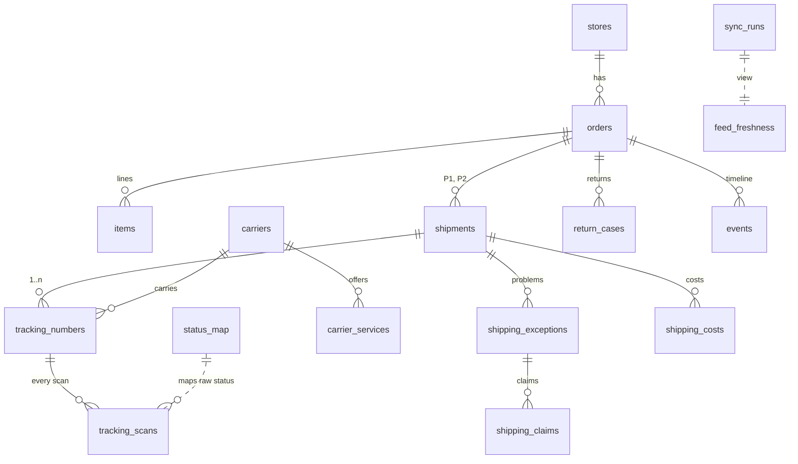

# Flowmerce Central Database — Complete Explanation

**Date:** 2026-11-17 · **Applies to:** `db/central/*.sql` · **Status:** written and reviewed by reading; **not yet run against any database** (no Postgres server or Supabase credentials were available in this session).

Companion documents: `docs/FLOWMERCE_DATABASE_AND_BUILD_PLAN.md` (the phased build plan and owner decisions) and the original design file `Ridhi_Shopify_Database_v2_Flowmerce.html`.

---

## Update — 2026-11-17 evening (refresh reads the hub's tables)

- The live database has **no tracker tables**: no `order_checks` or `manual_status`, and its `public.shipments` is the hub's own (empty) table, so `ops.refresh_from_tracker()` failed on every run. It is **replaced** by `105_refresh_from_shopify_orders.sql` → `ops.refresh_from_shopify_orders()`, which reads `public.orders` (+ `raw → fulfillments`), `public.stores` and `public.sync_runs`. Still never writes to `public.*`.
- One `ops.shipments` row per Shopify fulfillment, one `ops.tracking_numbers` row per tracking number, one `ops.tracking_scans` row per Shopify `shipment_status` word seen. Delivered time = Shopify's last update of the fulfillment; never carrier-confirmed.
- 5,051 of 6,741 fulfillments in `raw` hold only `createdAt` and are skipped (reported as `fulfillments_incomplete`). What the hub should add: `docs/shipping-schema-needs.md`.
- The points below about the tracker describe the earlier design and no longer apply to this database.

## Update — 2026-11-17 (Shipping built on Supabase)

- **Shipping is built** and reads this database through the Supabase REST API (`httpx`, no new package). See `docs/operations/shipping-supabase-setup.md`.
- **The one-time import draft was replaced** by `100_tracker_refresh.sql`: `ops.refresh_from_tracker()` runs inside Supabase every 15 minutes (and from the **Refresh now** button). It upserts orders, shipments and tracking numbers, adds a scan row each time a parcel's last scan time changes (so history builds up), opens and closes exceptions, copies team marks, and mirrors the tracker's sync runs for freshness. It never writes to `public.*`.
- **Checked against the live tracker tables:** real column names, 8 raw Shopify status words, and 10 carrier spellings (now in `ops.carrier_aliases`).
- **Accuracy findings from the live data:**
  - The tracker shows `NOT_DELIVERED` (9) and `DELAYED` (2) as "fulfilled". Flowmerce maps the raw word, so they appear as **delivery problems**.
  - All 4,036 deliveries are Shopify-reported only: shown as **delivered, not carrier-confirmed**.
  - 140 `CONFIRMED` parcels are shown as *label created*, not in transit.
  - 1,142 rows have no scan at all (source `shopify`): shown as unverified until scans arrive.
  - 106 blank and 58 "Other" carrier names: carrier **unknown**, never guessed.
- **Team marks:** stored in `tracking_numbers.team_mark*` plus a timeline event, never over the carrier status. Lost/failed opens an exception.
- **Security:** only Supabase `service_role` (server) has rights on `ops`/`seo`; `anon` and `authenticated` have none.

---

## 1. In one paragraph

Flowmerce will use **one Supabase PostgreSQL database**. Inside it, two sections (Postgres *schemas*) keep the modules apart: **`ops`** holds orders, shipments, tracking, carriers, alerts and data feeds (your v2 design), and **`seo`** holds the SEO & Blog module (an exact port of today's SQLite tables). Shared things (stores, settings, people, run logs) live in `ops` and are used by both. The Delayed Orders Tracker's live tables in `public` are **never touched**, so its hourly sync keeps working while the new system is built and proven.

```
Supabase PostgreSQL
├─ ops      26 objects from the v2 design + 4 Flowmerce additions + 3 extra views
├─ seo      20 tables ported 1:1 from data/blog-ops.sqlite
└─ public   Delayed Orders Tracker tables — untouched (read-only to Flowmerce, for the one-time import)
```

---

## 2. What was delivered in this package

| Item | Location | State |
|---|---|---|
| Central database SQL (13 files) | `db/central/` | Written, **not executed** |
| This explanation | `docs/architecture/central-database.md` | Done |
| Build plan + owner decisions + Phase 0 log | `docs/FLOWMERCE_DATABASE_AND_BUILD_PLAN.md` | Done |
| SQLite backup | `backups/pre-unification-2026-11-17/` (on the PC only, git-ignored, **not in the zip** because it holds business data) | Done |
| Safety branch | `safety/pre-unification-2026-11-17` (local, not pushed); 32 files staged | **Commit pending** (Git identity not set) |

**No application code was changed.** The SEO module still runs exactly as before on SQLite. The SQL is the foundation for Phases 1–4.

---

## 3. What changed compared with your v2 design file

Everything in the v2 design is kept: all 20 tables, every column, every index it lists, and all 5 views. The changes below are additions or safety adjustments, each with its reason.

### 3.1 Structural changes

| Change | Reason |
|---|---|
| Tables live in schema **`ops`**, not `public` | `public.shipments` and `public.sync_runs` already exist in the tracker with different columns. Creating v2 there would break the live hourly sync |
| `ops.stores.legacy_code` (`ridhi`, `cpc`) | The working SEO code uses these ids everywhere. Keeping them avoids touching working SEO logic while still linking SEO rows to the store table (decision D6 keeps `RBP`/`CPC` as the main code) |
| Foreign key `people.id → auth.users` moved to optional file `095` | Lets the schema run on plain PostgreSQL for rehearsal, and respects decision D3 (no login until Phase 5) |
| Carrier `unknown` (kind `unknown`) and shipment kind `unknown` | Imported rows whose carrier cannot be identified are labelled *unknown* instead of guessed |
| CHECK constraints on every status/kind/type column, using exactly the words listed in the design | Stops a typo (e.g. `deliverd`) from silently creating a new status |
| Extra indexes (orders open/placed, items by order/SKU, shipments open, events by order/shipment/open alert, tracking by number) | Match the screens' real queries: open work lists, order timeline, search by tracking number |
| `updated_at` kept current by trigger | Was described in the design but needs a trigger in Postgres |
| `ops.schema_migrations` | Records which SQL files were applied and when |

### 3.2 Accuracy additions (the shipping fix)

| Addition | What it solves |
|---|---|
| **`ops.status_map`** table | Every outside status word (Shopify, tracking service, tracker import) is mapped to the internal vocabulary **as data**, visible and fixable. Words not in the map become `pending` (unverified), **never** delivered |
| `status_map.confirms_delivery` | Only a source that can prove delivery (tracking service / carrier) counts. Shopify's "DELIVERED" is shown as delivered **but flagged not carrier-confirmed** |
| `tracking_numbers.delivery_confirmed` | The screen can say *"Delivered — confirmed by DHL"* vs *"Delivered — Shopify only"* |
| `tracking_numbers.raw_status` | Latest status exactly as the source wrote it |
| `tracking_numbers.last_checked_at / last_check_ok_at / last_check_error / check_attempts` | Freshness **per tracking number**: when we last asked, when it last worked, what went wrong |
| CHECK: `status = 'delivered'` requires `delivered_at` | A parcel can never be "delivered" without a delivery time |
| `tracking_scans.mapped_rule` | Each scan records which mapping rule produced its status (auditable) |
| Function **`ops.recompute_tracking_status()`** | Current status = newest scan **by when it happened** (`scanned_at`), not by arrival order. Old late messages can't overwrite new ones |
| Unique open exception per shipment + tracking + kind | The alert job can't raise the same problem twice |
| `sync_runs.lock_key` + unique index | The same feed can never run twice at the same time |
| `origin` and `kind_inferred` columns | Imported rows are always recognisable, and guesses are flagged for review |

### 3.3 New views

| View | Use |
|---|---|
| `ops.feed_freshness` | Last attempt, last success, last error, failures in 24 h — per feed. Powers the "synced 12 min ago ✓ / ⚠" badges |
| `ops.shipment_diagnostics` | The problem list: no scans, no movement, missing carrier, delivered-but-unconfirmed, status contradicts scans, source keeps failing, duplicate tracking, shipped without tracking, open exception, unconfirmed imported kind |
| `ops.shipping_summary` | Small per-store numbers for Home (in transit, delivered, exceptions, unverified) without loading whole tables |

---

## 4. Every table, by group

### 4.1 Set-up (shared by both modules)

| Table | Key | Holds |
|---|---|---|
| `ops.stores` | `id` (RBP/CPC) | The two Shopify stores, timezone, currency, `legacy_code` for SEO |
| `ops.people` | `id` (uuid) | Team members: team, title, head of team, sections, stores, cost visibility |
| `ops.settings` | `key` | Every shared rule as JSON: write switches (OFF), working hours, step limits, escalation, reason lists, GST numbering |
| `ops.carriers` | `id` | DHL, FedEx, Amazon Logistics US, USPS, Shiprocket, Delhivery, unknown |
| `ops.carrier_services` | `id` | Express / Standard / Surface with normal delivery days |
| `ops.shipping_accounts` | `id` | Accounts we ship through; only the *name* of the secret |
| `ops.status_map` | (source, carrier, raw) | Outside status → Flowmerce status |

### 4.2 Orders and work

| Table | Key | Holds |
|---|---|---|
| `ops.orders` | Shopify order id | Shopify's copy + our stage, due time, late, hold, dispute, alerts |
| `ops.items` | Shopify line id | Quantities (ordered/edited/refunded/shipped/open) + our route decision |
| `ops.shipments` | uuid | Anything that moves (MCF, India, production, return, replacement), its step, responsible person, carrier, costs |
| `ops.stock` | (store, sku) | ERP stock copy (empty until ERP access) |
| `ops.events` | bigserial | The full timeline: Shopify messages, step changes, scans, notes, actions, alerts and their life |

### 4.3 Tracking and problems

| Table | Key | Holds |
|---|---|---|
| `ops.tracking_numbers` | uuid; unique (carrier, number) | Truth for tracking: source, status, times, freshness, delivery confirmation |
| `ops.tracking_scans` | bigserial; unique external_id | Every scan, raw and normalized |
| `ops.shipping_exceptions` | uuid | Problems from detection to closure |
| `ops.shipping_claims` | uuid | Money claimed from carriers |
| `ops.return_cases` | uuid | Returns and sent-back parcels |

### 4.4 Costs and feeds

| Table | Holds |
|---|---|
| `ops.shipping_costs` | Real/estimated cost lines per shipment |
| `ops.rate_cards` | Expected carrier prices |
| `ops.webhook_inbox` | Incoming messages stored untouched (empty until a public endpoint exists) |
| `ops.sync_runs` | Every load/poll/import run |

### 4.5 SEO & Blog (`seo` schema)

`users`, `sessions` (obsolete, kept), `brand_settings`, `topics`, `keywords`, `articles`, `article_revisions`, `review_notes`, `publish_requests`, `workflow_runs`, `automation_state`, `integration_status`, `gsc_page_daily`, `gsc_query_period`, `ga4_page_daily`, `products`, `audit_log`, `imports`, `ai_jobs`, `ai_job_events`.

Every column, default, unique rule and index from `src/flowmerce/modules/seo/db.py` is present. Type conversions (identical for every table):

| SQLite | PostgreSQL | Why |
|---|---|---|
| `INTEGER PRIMARY KEY` | `bigint generated by default as identity` | Keeps existing ids on copy; new ids continue after the highest |
| 0/1 integers (`active`, `shopify_published`, `paused`) | `boolean` | Real true/false |
| `*_json` text | `jsonb` | Validated JSON, queryable |
| ISO-8601 text times | `timestamptz` | Correct time-zone handling |
| date text | `date` | Correct date sorting/filtering |
| `REAL` | `double precision` | Same precision |
| `COLLATE NOCASE` email | unique index on `lower(email)` | Same case-insensitive rule |

Added SEO indexes (from the audit's missing-index list): `articles(topic_id)`, `articles(brand_id, shopify_article_id)`, `review_notes(article_id)`, `publish_requests(article_id)`, `audit_log(brand_id, ts)`.

### 4.6 How the shipping tables connect



---

## 5. How data flows

### 5.1 A tracking update (the accuracy path)

1. A scan arrives (polling now; webhook later) from the tracking service, Amazon, a carrier, or Shopify.
2. If its `external_id` was already stored → ignored (never twice).
3. Its raw status is looked up in `ops.status_map` for that source. Not found → `pending`.
4. A `tracking_scans` row is written with raw + mapped status and the rule used.
5. `ops.recompute_tracking_status()` picks the **newest scan by scanned_at** and updates the tracking number. `delivery_confirmed` is true only if that scan came from a source that can confirm delivery.
6. `last_check_ok_at` is updated; on failure `last_check_error` and `check_attempts` instead.
7. `shipment_diagnostics` shows anything wrong (no movement, contradiction, failing source...).

### 5.2 Where every displayed status comes from

| On screen | Comes from | Trust level shown |
|---|---|---|
| Delivered ✓ (confirmed) | `tracking_numbers.status = delivered` and `delivery_confirmed = true` | Carrier-confirmed |
| Delivered (Shopify only) | `status = delivered`, `delivery_confirmed = false` | Not carrier-confirmed |
| In transit / Out for delivery | latest scan status + `source` | "via Shopify" / "via DHL" |
| Pending / unverified | no scans, or an unmapped status | Unverified |
| Freshness badge | `feed_freshness` + `tracking_numbers.last_check_ok_at` | Age of the data |

### 5.3 SEO

Unchanged today (SQLite). At Phase 4 the same flows (Shopify sync, Search Console, GA4, AI jobs, approvals, publishing) write to `seo.*` instead, through one shared database connection in the backend.

---

## 6. Moving existing data in

### 6.1 Tracker → `ops` (file `100_import_from_tracker.DRAFT.sql`)

| Tracker | Becomes | Rule |
|---|---|---|
| `public.shipments` order fields | `ops.orders` (minimal) | `shop_updated_at = -infinity`, so the first real Shopify sync fills the rest |
| `public.order_checks` | order status, note, total | joined by order number |
| one Shopify fulfillment | one `ops.shipments` row | kind guessed from carrier and **flagged** `kind_inferred` |
| each tracking number | one `ops.tracking_numbers` row | `source = tracker_import`, mapped status, `delivery_confirmed = false` |
| `last_scan_at` (only if present) | one `ops.tracking_scans` row | no scan is ever invented |
| `public.manual_status` | not imported yet | columns unknown; will become `ops.events` |

Safety: checks the expected columns exist first, runs in one transaction, never writes `public.*`, and adds only missing rows if run again. `110_validate.sql` then lists counts side by side, rows that could not be imported and why, the status comparison, and a random sample of 20 for checking against Shopify admin.

### 6.2 SQLite → `seo` (Phase 4)

Copy each table with its ids, convert types as in §4.5, move each identity past the highest id, compare row counts and checksums per table, run all SEO tests on Postgres, and keep the SQLite file as the rollback for at least 30 days. (The `unified_db` loader described in the audit is not in this copy of the project, so the copy script will be written in Phase 4.)

---

## 7. Security

- **RLS on for every `ops`/`seo` table with no policy for browser keys** → the public anon key reads nothing. Fixes the audit's finding that `using (true)` exposed shipments and order notes.
- **One backend role, `flowmerce_app`**, with exactly the rights it needs; created without a password (owner sets it). It may only **read** the tracker's `public` tables.
- **Default privileges** so later tables are covered automatically.
- **No secrets in the database**: only `credential_ref` names.
- **Write switches** `shopify_writes`, `amazon_writes`, `auto_mcf` seeded **OFF**.

---

## 8. How to run it (when ready)

1. Create a **throwaway** Supabase project (or local Postgres 15+) for rehearsal.
2. Run files `000` → `090` in order (commands in `db/central/README.md`). Each is safe to re-run.
3. Run `110_validate.sql` sections A–C: all tables exist, RLS on, switches off.
4. Only on the real project, and only after the owner approves: run `100_import_from_tracker.DRAFT.sql`, then `110_validate.sql` D–I.
5. Rollback: `rollback/999_rollback_central.sql` removes `ops` and `seo` only, and refuses if real data exists unless explicitly allowed. Back up first.

---

## 9. Honest status

| Item | Status |
|---|---|
| v2 design converted to SQL (all tables, columns, indexes, views) | **Written, not executed** |
| SEO SQLite schema ported to Postgres | **Written, not executed** |
| Accuracy additions (status map, delivery confirmation, latest-status function, diagnostics, freshness) | **Written, not executed** |
| Tracker import | **Draft**: column names from the audit, not verified against the live table |
| SEO data copy | Planned (Phase 4) |
| Backend reading/writing these tables | Not started (Phase 1–2; needs `psycopg`, approved) |
| Tracking service connection | Blocked: owner to choose AfterShip or 17TRACK and create the account |
| SQL syntax checked by a Postgres server | **No**: no server available in this session. First rehearsal run is the check |

## 10. Owner checks before go-live

1. Confirm each store's `myshopify.com` domain. The seed uses `guz0he-21.myshopify.com` (Ridhi) and `liquidationfashion.myshopify.com` (CPC), taken from the project's `.env.example`; the design file's example `ridhiblockprint.myshopify.com` was not used.
2. Confirm the step time limits (production total "to confirm").
3. Run the tracker's `inspection.sql` (or share `public.shipments` / `manual_status` column lists) so the import draft can be finalised.
4. Choose the tracking service, then confirm its status words against `status_map`.
